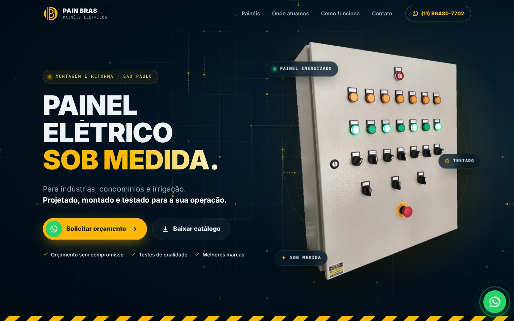
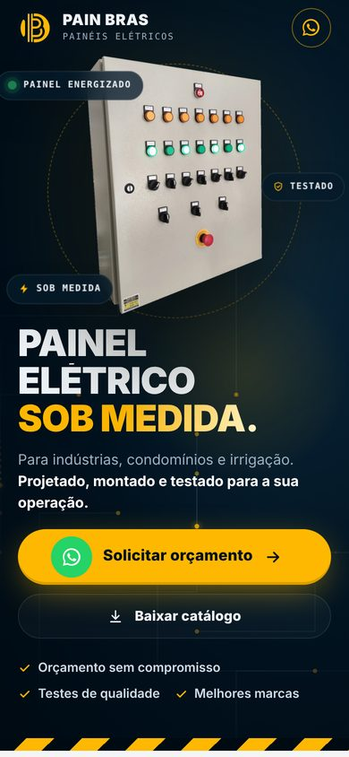

# Pain Bras — Site

Site de vendas da Pain Bras, fabricante de painéis elétricos industriais sob medida em São Paulo.
Sales website for Pain Bras, a São Paulo maker of custom industrial electrical panels.

🌐 **No ar / Live:** [painbras.vercel.app](https://painbras.vercel.app)

[🇧🇷 Português](#-português) · [🇺🇸 English](#-english)

  
  

---

## 🇧🇷 Português

Página única de vendas para a Pain Bras (painéis elétricos industriais), com foco em levar o visitante para o WhatsApp.

- Site estático: `index.html`, `assets/css/style.css`, `assets/js/main.js`. Sem build e sem dependências.
- Para ver: abrir `index.html` no navegador, ou rodar `python -m http.server` nesta pasta.
- Conteúdo, fotos, logo, marcas e catálogo vieram do site atual do cliente (painbras.com) e do catálogo em PDF.
- Número do WhatsApp e mensagem padrão: topo de `assets/js/main.js`. Cada botão pode ter sua própria mensagem em `data-wa="..."`.
- Fundos opcionais gerados por IA: ver `PROMPTS-IMAGENS.md`.

Repositório: github.com/GabrielSchandler/painbras. A branch `main` publica sozinha em https://painbras.vercel.app (Vercel).
O site antigo (Next.js) está guardado na branch `site-antigo-nextjs`.

---

## 🇺🇸 English

A single-page sales site for Pain Bras (industrial electrical panels). Its goal is to bring visitors to WhatsApp for a quote.

- Static site: `index.html`, `assets/css/style.css`, `assets/js/main.js`. No build step, no dependencies.
- To preview: open `index.html` in a browser, or run `python -m http.server` in this folder.
- Content, photos, logo, brands and the catalog came from the client's current website (painbras.com) and its PDF catalog.
- The WhatsApp number and default message are at the top of `assets/js/main.js`. Each button can set its own message with `data-wa="..."`.
- Optional AI-generated backgrounds: see `PROMPTS-IMAGENS.md`.

### Deployment

The `main` branch deploys automatically to https://painbras.vercel.app (Vercel). The previous Next.js site is kept in the `site-antigo-nextjs` branch.
